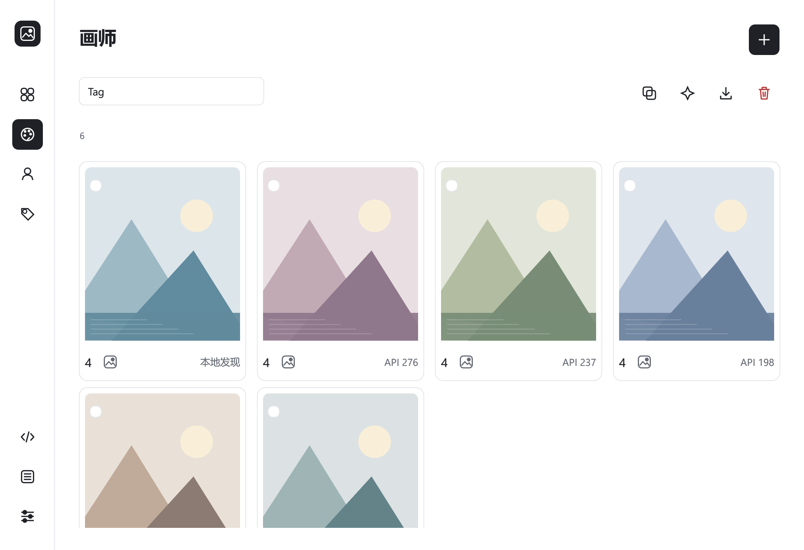
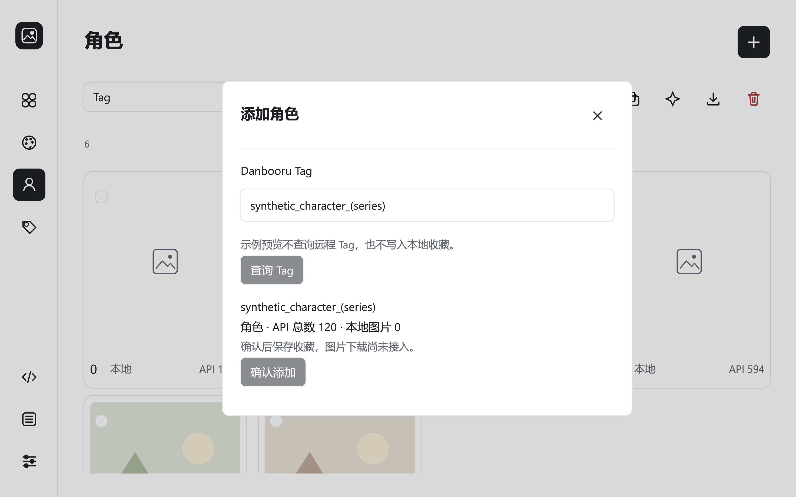
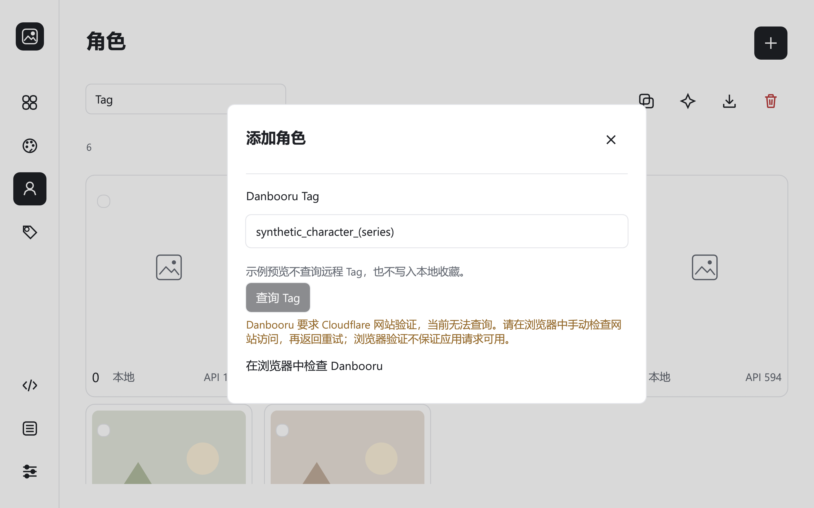
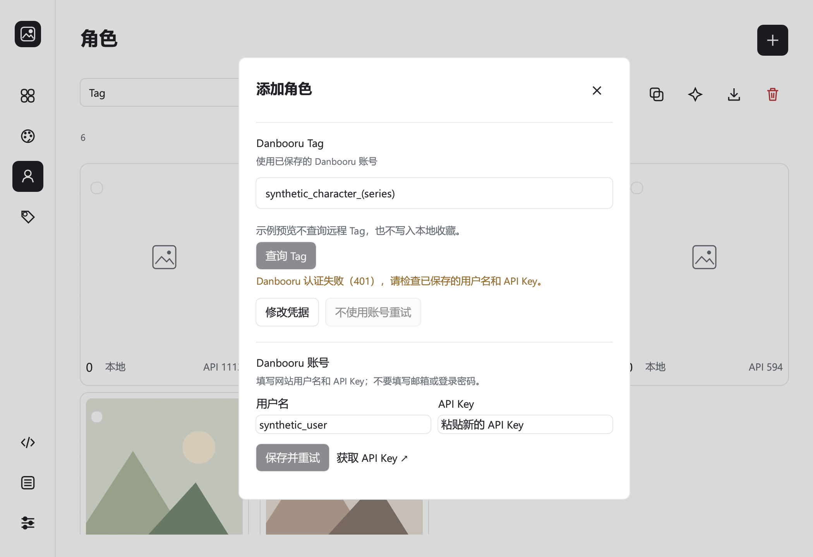

# 画师与角色收藏：Tag 查询和记录持久化

Current catalog is SQLite v4. The historical v1 descriptions below document the earlier slice. See [workflow delivery](../planning/WORKFLOW_DELIVERY.md).

2026-10-23：下载角色图片时，所有来源画师标签自动生成画师卡片，并关联同一张本地图片。正常启动从全部 `media_sources` 补齐旧库，不重新下载；去重合并保留的其他来源也参与补齐。未知远程 Tag ID 和图片总数保存为 NULL，卡片显示「本地发现」，不会伪造 API 数字。直接进入画师图库、下载均可用；后续手动查询同名画师时补上来源身份/总数，保留本地 ID 和图片关联。只自动发现画师，角色收藏仍由用户添加。删除仍沿用已确认的共享图片删除范围；来源随图片删除后，补齐不会复活已删除记录。



## 当前可用流程

正常启动 `cargo run --locked -p bdm-desktop`。在画师或角色页点击添加，填写一个完整 Danbooru Tag，点击“查询 Tag”。查询成功后显示规范化 Tag、分类、来源图片总数和当前本地图片数；点击“确认添加”才写入本地数据库。添加收藏不会下载图片，所以新卡片的本地图片数为 0，封面显示占位图。

没有已保存账号时使用公开匿名查询。需要账号的查询先在系统设置保存用户名/API Key；查询只读取系统凭据存储中的已保存凭据，未保存的输入不参与请求。保存账号不发起网络请求，不代表认证已通过。读取已保存凭据失败时提示修复，不偷偷换用另一个账号。

401 或凭据读取失败时，弹窗提供“修改凭据”和“不使用账号重试”。修改凭据可在当前弹窗填写网站用户名及 API Key，点击“保存并重试”先安全保存，再查询原 Tag；Tag 和收藏类型保留。公开重试由用户主动选择，不读取、不删除、不替换系统凭据，只对本次添加弹窗使用匿名模式；重新打开添加恢复默认账号模式。未保存的 Key 在关闭或 Escape 时清空。

系统设置的“验证连接”在后台读取已保存凭据，通过固定 HTTPS `/profile.json?only=id,name` 检查返回的账号身份，分别显示未验证、正在验证、认证通过和验证失败。修改或移除凭据使旧验证和旧 Tag 结果失效；旧请求结束前不会重复启动同类请求。账号验证通过不代表图片采集或所有接口权限已验证。

输入去除首尾空白并转换为小写；拒绝多个 Tag、网址、搜索通配符、路径和控制字符。必须精确匹配来源返回的 Tag 名称，画师分类为 1，角色分类为 4；分类错误提示到对应页面添加。未知 Tag、其他分类、异常响应和查询失败均不创建记录。输入和错误原因保留，可修改后重试；修改 Tag 后必须重新查询。



## 查询、取消和错误

HTTP 查询在独立线程执行，UI 显示等待状态，仍可关闭弹窗或切换页面。一个应用实例最多保留一个进行中的请求；关闭或 Escape 丢弃结果，不写库。当前取消是逻辑取消，已发出的请求会在完成或超时后结束，期间不启动第二个请求；重新打开后旧结果不会填入新表单。查询没有自动重试，也不自动切换 Gelbooru。

请求固定为 `https://danbooru.donmai.us/tags.json`，只获取 `id,name,category,post_count`；禁用重定向，连接超时 5 秒，总超时 12 秒，响应上限 64 KiB。已保存账号通过 HTTPS Basic Auth 使用，密钥不放进 URL。识别 `cf-mitigated: challenge` 为 Cloudflare 网站验证；401 为认证失败，普通 403 为访问拒绝，429 为限流。200 响应要求 JSON Content-Type，HTML 不会被解析成 Tag。网站验证、认证、访问拒绝、限流、网络/超时、服务异常和格式异常分别显示脱敏错误，不打印响应正文或底层可能携带敏感信息的异常。

### Cloudflare 验证导致添加失败

2026-10-21 对 `phoenix_reffaella` 的匿名请求实际返回 HTTP 403、`Content-Type: text/html`、`cf-mitigated: challenge`，内容是网站验证页。因此此次失败不能说明角色不存在或 API Key 错误。程序会保留 Tag，不创建收藏，显示可换行的完整原因及“在浏览器中检查 Danbooru”链接。

用户需要在自己的浏览器中手动检查网站访问；程序不读取浏览器 Cookie、不代办网站验证、不自动重试验证页或换来源规避拒绝。浏览器验证和桌面 API 请求是不同会话，完成浏览器验证不保证桌面请求可用。只有请求恢复并返回有效的 Danbooru 元数据后，才可确认添加。账号的 401 或普通 403 另按认证/权限问题处理。



同日后续真实检查：匿名查询已返回 200，确认 `phoenix_reffaella` 为角色，Tag ID `2726116`，当时 API 总数 `1095`；Rust 适配器公开查询测试通过。当前系统保存的账号 `/profile.json` 验证仍返回认证失败，因此可使用用户选择的公开重试恢复角色查询，或更新凭据后重试；这些检查未创建收藏、未下载图片、未修改已有凭据。



## 持久化与重复添加

数据库默认位于项目目录下的 `data/catalog.sqlite3`，与偏好文件 `data/app.ron` 分开，默认图片目录为 `data/library/`。首次正常启动会创建数据目录和空数据库，后续启动加载记录。系统设置中的托管根目录只影响后续下载，不迁移已有图片或切换数据库。

来源身份 `(provider, source_tag_id)` 和 `(provider, tag)` 在数据库中各自唯一。重复添加相同来源身份返回原记录，保留本地 ID、添加顺序和已有来源总数，不创建第二张卡片。API 总数是添加时获取的快照，尚未实现定期刷新。卡片按递增本地 ID 的逆序展示，新记录置顶；搜索和翻页不修改添加顺序。

只有事务提交成功才更新界面并提示成功。写入失败保留表单及查询结果；打开失败显示错误，可重新打开，不能覆盖原数据库或假装加载了空库。当前只存收藏元数据，尚未存储原图、标签侧车、媒体关系或后台任务。收藏列表仍整体加载到内存，仅当前页渲染；生产级数据库分页和大规模性能未验证。

## 删除边界

沿用画师/角色页单一工具栏删除入口，选中记录后核对确认范围。当前 v1 数据库只包含无本地图片的收藏记录；可在单个事务中删除这类记录，取消不写库，重启后删除仍生效。任一 ID 缺失、类别改变或范围失效都会回滚整批删除。

有本地图片的真实记录必须走 D-134 的图片、侧车、数据库和全部引用协调清理；该服务尚未实现，不能用仅删收藏行替代。此类范围保持禁止执行。数据库版本变更也会阻止 v1 的空记录删除路径。开发示例已有的级联删除仍仅作用于内存。

## 模式隔离与验证

`--preview` 不打开收藏数据库、不加载真实来源凭据、不发起 Tag 查询、不保存真实收藏；示例 API 数字为合成数据。`--capture` 同样不读取真实凭据和收藏库，查询中、失败、成功表单使用合成状态，确认添加禁用。截图中的来源信息不能当作真实 API 验证。

离线测试覆盖输入规范化、分类/身份校验、重复添加、Unicode/空格路径、事务回滚、关闭与迟到结果、保存失败、重启恢复、持久化删除及模式隔离。原生截图覆盖最小窗口下的表单输入、等待、失败和结果呈现。具体执行结果见 [实现状态](../planning/IMPLEMENTATION_STATUS.md)。

公开匿名接口验证单独执行：

```powershell
cargo test --locked -p bdm-infrastructure live_public_tag_lookup -- --ignored
```

该测试只查询公开 Tag，不读取用户凭据，不下载图片。通过它只能证明本次匿名元数据查询可用，不能证明登录认证、图片采集、分页、重试或访问受限内容已完成。
