# 桌面 UI 设计与实现

去重面板增加“筛查背景／内容变化的相似图”，默认开启，门槛默认 0.95；数值可调并提供 0.95／0.92／0.90 快捷值。门槛只控制人工候选，严格双信号自动删除规则保持独立。总览只展开最近完成任务及待继续任务，旧批次收进历史；显示自动移除／本次发现数，提供“审核相似图”和“重新筛查相似图”。候选两图并排放大、按相似度排序，每页五对，显示文件名和尺寸；点击图片进入这两张原图的审核范围。调整门槛后点击“开始筛查”，已有特征直接复用。背景变化较大时仍可能漏检，不把相似分数当作人物主体一致的证明。

[相似图任务摘要](images/similarity-summary.png) · [相似图筛查和对比](images/similarity-candidates.png)。target/ui-similarity-delivery-20261022 完成 46 帧，实际 1050×720，stderr 为空；紧凑弹窗顶部及底部操作均可见，候选拒绝按钮在内部滚动区域。截图使用隔离示例数据。当前主程序仍为 target/debug/bdm-desktop.exe。

编辑区和“系统设置 → 图片编辑”新增共享开关“编辑后二次确认”，默认开启，自动记住。开启时显示预览和确认流程；关闭时显示“直接保存 · 处理成功后替换当前图片”，操作按钮变为“裁剪并保存／去水印并保存”。选区绘制不触发保存；每次执行时固定其确认模式，等待中及已有预览时编辑区开关禁用。结果成功保存后继续保留所选修复工具，便于反复操作。过期结果或保存失败不报告成功。删除及文本确认保持独立。

裁剪／修复的图片编解码、缩略图、校验和写入移到后台，保存阶段显示“正在保存…”，界面继续响应；直接保存跳过显示预览的解码和上传。关闭／切图时，持久化保存意图之前取消，已经写入恢复日志的保存完整完成；全局接收完成结果，更新对应图片尺寸及缓存，不重置新图片的编辑区。开发主程序的图片编解码依赖启用优化。3442×2160 合成 JPEG 裁为 3000×1800 的本机测试约 0.9 秒，界面结果轮询低于 1 毫秒；不包含保存后原图的 GPU 上传。

[裁剪直接保存模式](images/crop-direct-save.png) · [去水印直接保存模式](images/inpainting-direct-save.png) · [系统设置开关](images/image-edit-settings.png)。本次原生截图完成 44 帧，实际 1050×720，stderr 为空；截图使用隔离示例数据，真实处理及保存行为由临时目录测试验证。

程序入口统一为 `target/debug/bdm-desktop.exe`，包含所有当前功能。此前带 inpainting、crop、review-ui 后缀的构建已移到 `target/archived-builds/2026-10-22/`，仅供归档；后续使用和交付均引用主程序。构建缓存目录保持原有位置。

审核页排版修订（2026-10-22）：浅灰工作区承托图片画布和白色右栏；等宽“标签与描述／局部修复／裁剪”切换使用统一深蓝选中样式。画师、角色标签合为两行身份信息卡，通用标签保留独立滚动区域。裁剪比例、输出尺寸以及修复模型、选区工具分别归入工具卡；预览、确认与取消按钮统一宽度，主操作使用深蓝强调。底部审核按钮分离文字与快捷键标记，保留固定判断、切图和自动下一张。所有编辑、复制和保存行为保持原有语义。截图证据：target/ui-review-polish-20261022，41 帧，实际 1050×720，stderr 为空；同时由 UI 测试覆盖支持窗口尺寸。最新程序：target/debug/bdm-desktop-review-ui.exe。

当前已接入下载、角色本体／变体关系、标签解析、文本优化、pHash/DINOv3 去重、真实媒体删除与基础导出。后文的“尚未接入”描述属于早期界面验证记录；当前范围与限制见 [工作流落实记录](../planning/WORKFLOW_DELIVERY.md)。

## 设计方向

依据用户再次反馈，界面改为图片与图形优先：纯白工作区、72 像素图标导航、单一页标题，不设置顶栏面包屑、底部状态栏或侧栏说明。删除面向用户的示例预览入口，示例只通过开发参数载入。

总览以六张近期图片为主体，旁边用四个可点击环形指标呈现文本覆盖；顶部只保留图标、数量及简短名称。移除空白后台任务卡片。图库的布局、返回、选择、重置和批量操作使用图标按钮；文件名与完整状态放入悬停信息。必要的表单字段、筛选选项和处理范围保留文字。

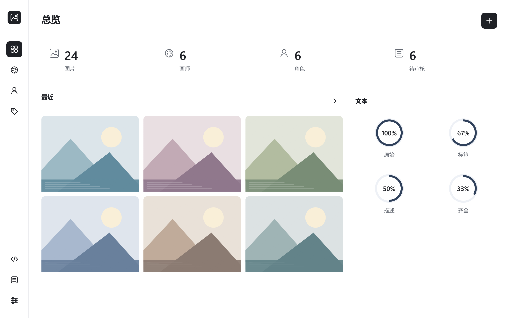

[网格图库截图](images/gallery.png) · [1050×720 窗口的导出弹窗](images/export-compact.png)

- 推荐窗口：1440 × 960 逻辑像素；最小窗口：1050 × 720，内容纵向滚动。
- 图标导航宽 72，内容边距 32；图标点击区域 40×40，图形宽 18。保持七个导航入口，悬停显示名称；图标按钮提供可访问名称。卡片间距 12–16，圆角 6–10。
- 标题 24、区块标题 15、正文/按钮 14、常用辅助信息 12–13。Windows 英文与数字使用 Segoe UI，中文回退到微软雅黑 UI（TTC 字面索引 1）；标题/数字使用独立字体族匹配 Segoe UI Semibold 与中文粗体，不依靠颜色模拟字重。加载系统字体，不分发字体文件。
- 主按钮使用深灰填充，一般操作使用白底浅描边；选择项使用浅蓝灰或中性灰填充。正文 `#1F2126`，辅助文字 `#646972`，白底对比度分别约 16:1 与 5.5:1。
- 审核状态以勾选/时钟的不同图形区分，完整文字在悬停与详情中显示，不仅依赖颜色。服务未实现的操作保持禁用，原因放在控件悬停提示中。

## 信息架构

遵循 D-096 的七个入口，不增加独立的顶层图库或冲突管理页面。

| 页面 | 负责的内容 | 已实现的界面交互 |
|---|---|---|
| 总览 | 媒体/画师/角色数量、审核数、文本覆盖环图、最近图片 | 指标跳转对应范围；最近图片打开详情；空库图形添加入口 |
| 画师 | 画师卡片、关联图库、批量操作入口 | 来源 Tag 查询/确认添加、SQLite 重启恢复、即时搜索、多选、自适应卡片、分页、图片浏览 |
| 角色 | 角色卡片、关联图库、批量操作入口 | 与画师一致的查询、收藏和浏览模式；身份/变体编辑尚未接入 |
| 标签管理 | 标签分类、受保护名称、解析/冲突入口 | 全量标签搜索、分类切换、20／50／100 条分页、可见行渲染、缓存统计与冲突、关联图片跳转；原始标签只读 |
| API 配置 | 服务地址、独立 API Key、模型、成员并发上限、显式限流组 | 新建/编辑/删除、地址校验、密钥安全保存/移除，连接未验证 |
| 运行日志 | 当前会话的可见操作与错误 | 级别筛选、文本搜索，内存中保留最近 500 条 |
| 系统设置 | Danbooru 来源凭据、托管目录、模型目录、备份、应用信息 | Windows 凭据安全保存/移除、保存路径偏好；区分设置偏好与实际迁移 |

## 关键交互约定

### 画师与角色

角色页只显示确实需要确认的歧义关系；已生效关系、数量、处理状态、刷新及手动表单都移到“系统设置 → 角色关系 → 角色关系设置”。没有待确认项时，角色关系不占页面空间。自动处理结果继续生效，无需二次审核。设置弹窗按需查看已生效列表（最多 180 像素并可滚动）、刷新来源关系、离线重试及手动添加／移除；关闭后不会在角色页留下已处理列表，也不使用旧的折叠展开状态。

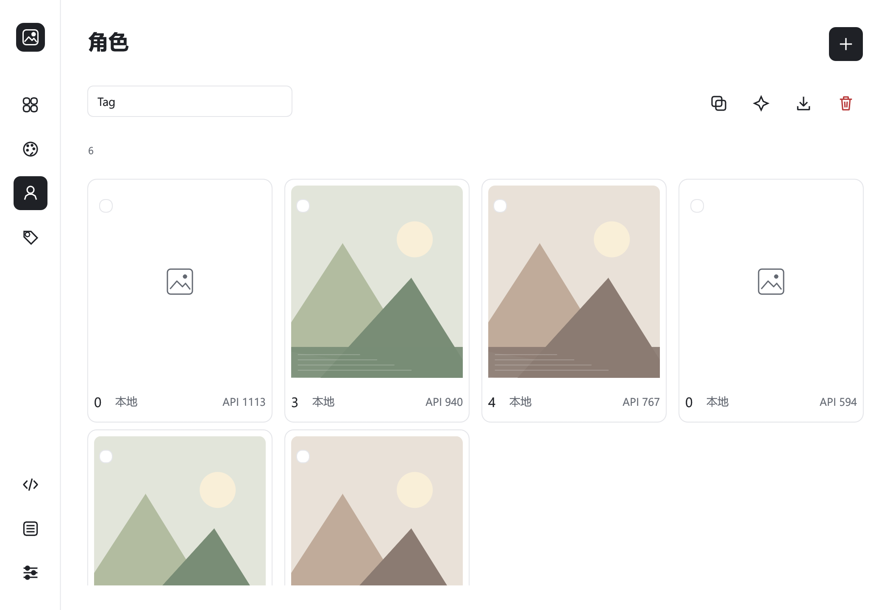

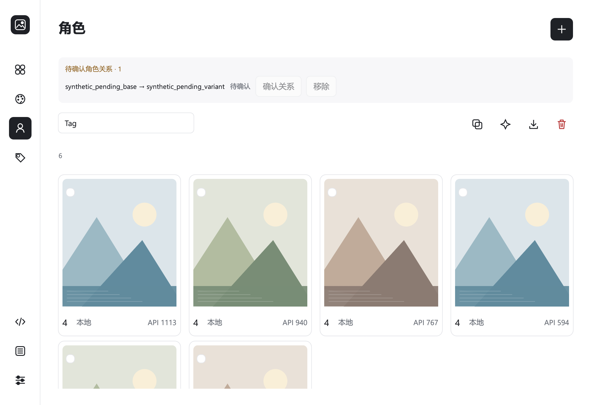

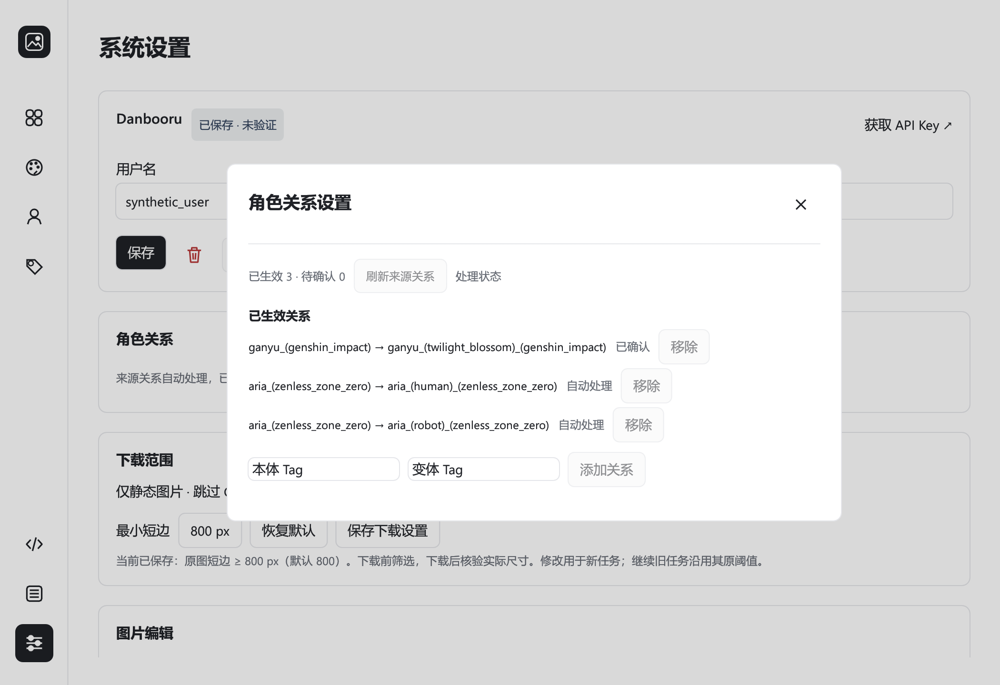

角色关系自动处理（2026-10-22）：进入空闲角色页时，旧版缓存中有确切 Danbooru 有效蕴含依据的待确认关系自动处理并更新本地整理标签；“从 Danbooru 自动处理”按需查询新关系。“处理已发现关系 N”用于离线重试。只有来源不明、循环等无法自动处理的关系需要确认，手动移除保留。按用户澄清，界面已移除互斥组入口：仅去掉已确认变体对应的冗余本体 Tag，多个角色和具体变体同时出现均保留，不据此报冲突。此前的 [角色页截图](images/character-auto-compact.png) 属于移除互斥组之前的版本。

卡片只显示封面、本地图片数和 API 总数；Tag 在搜索和悬浮说明中使用，不作为卡片标题。来源总数与本地关联数严格区分。封面从最新关联图片派生，无图片时显示占位图，不提供封面固定操作。

默认按记录添加顺序倒序，搜索实时生效并回到第一页；每页默认 50，可选 20/50/100，提供上一页、下一页和可输入的页码。勾选卡片用于批量操作，点击封面进入关联图库。

画师/角色列表只在顶部工具栏保留一个垃圾桶，卡片上不显示删除按钮。先点垃圾桶进入删除选择，再点封面或复选框选择/取消选择；此时点击封面不进入图库。工具栏仅显示“删除 N”和取消按钮，无选中项时无法打开确认。取消或 Escape 退出选择，切换页面也会清空此状态。打开确认窗口时冻结记录和关联图片的 ID，显示 Tag、待删图片缩略图/文件名及两类删除数量；取消、关闭和 Escape 返回选择，确认后退出删除模式。删除画师/角色表示同时删除其关联的唯一图片及专属标签、描述、审核和分析数据（D-134）；同图在其他页面的引用也移除，不能留下仅在总览可见的幽灵图片。

其他未选中的画师/角色记录及无关图片保留，其计数与封面从剩余唯一媒体派生；不会沿另一类记录继续扩大删除范围。确认中的关联发生变化时要求重新确认，不能删除未展示的图片。删除使用与图库一致的媒体清理路径，清理媒体多选、待删除队列、审核顺序、旧操作范围、页码和已删除记录的浏览上下文。当前带图片的级联删除只有内存示例能执行，真实原图、侧车和缓存清理仍未接入；无本地图片的收藏记录已支持 SQLite 事务删除。

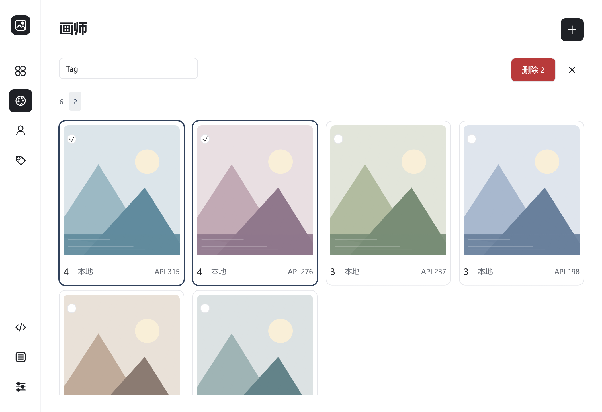

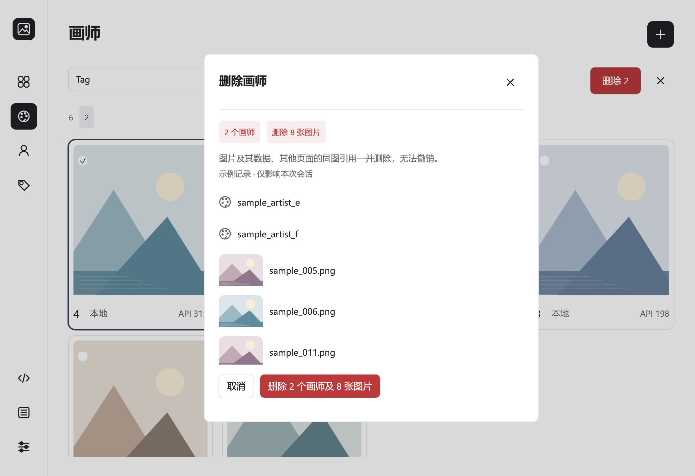

添加弹窗已接通 Danbooru Tag 后台查询：保留输入与失败原因，精确校验名称及画师/角色分类；查询成功显示分类与 API 总数，点击“确认添加”才写入 SQLite，不创建没有来源元数据依据的记录（D-104/105）。查询中显示等待状态，可关闭或切页；取消后的迟到结果被丢弃。重复添加返回原记录，重启恢复收藏，新记录无本地图片时显示空封面。详见 [收藏流程](../features/COLLECTION_CATALOG.md)。

真实收藏 v1 只含无本地图片的记录，可通过同一选择/确认入口事务删除；有图片的真实记录仍禁止执行，等待 D-134 的协调媒体清理。数据库打开失败显示错误与重新打开入口，保存失败不显示成功。

### 图库

默认网格，可切换瀑布流；布局切换不修改排序、选择或元数据。筛选组合包含空格分隔的 Tag、审核/文本状态、来源、尺寸下限。排序包含最新导入、文件名、像素面积和评分，使用媒体 ID 打破平局。

勾选、选择筛选结果和清空选择均可用。点击图片打开详情，查看三种独立文本、图片尺寸和审核状态。示例图片可以在“保留/待审核”之间切换，变化仅在当前示例会话中生效。

### 审核与删除（D-080～D-083）

缩略图／原图预览状态仅显示在画布上方的工具栏，不在图片上覆盖文字，避免遮挡内容。

“系统设置 → 图片查看 → 审核时自动加载原图”显式控制审核默认，关闭时使用缩略图（新设置及旧版偏好均默认关闭），开启时打开审核／切图会后台加载原图。审核页手动切换仅影响当前图片，切图采用已保存默认；关闭审核释放原图。缩略图上的裁剪和修复选区按原图尺寸映射，保存后修改原图文件；缩放和平移仅改变查看位置。设置自动记住并在重启后保留。

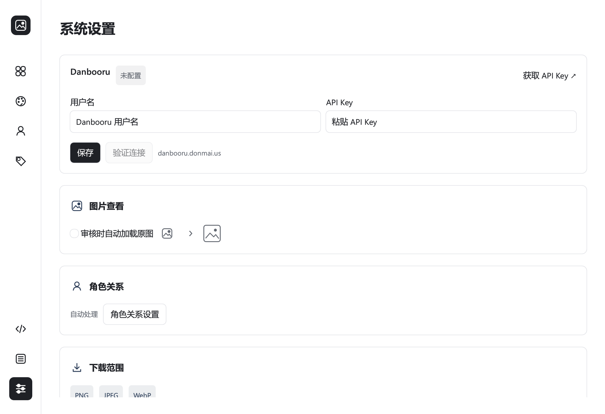

审核使用占满应用窗口的工作区，隐藏底层导航和图库：顶部展示文件名、尺寸、审核状态及待删除清单，画布默认使用整行宽度。第二行“描述”按需展开可收起的右栏，再按“原始标签／优化标签／自然语言”切换，默认栏目为原始标签。导入时的本地整理不算优化结果；未启动对应目标时显示“尚未优化标签／尚未优化自然语言”，复制禁用且没有文本确认按钮。已有任务但无结果时显示该目标的任务状态，待人工确认的有效结果仍可查看。切换栏目不会启动优化。打开图片默认只展示标明的缩略图；点击“加载原图”后在后台解码，失败提供重试，不反复解码。“使用缩略图”释放原图，切图或关闭审核也释放原图并恢复缩略图默认。画布保持原始比例，支持以指针为中心的滚轮缩放、拖动平移、双击／按钮适应窗口、100% 物理像素查看及加减缩放，切图重置视图。缩放和平移只修改视口，不改变文件。

画师／角色／作品在浅底信息块中按固定列对齐，普通标签使用 13 像素字号并换行；过长名称限制在内容面板内。优化标签仅在显示时隐藏 `@artist` 标记并将下划线替换为空格，悬停与整段复制保留原文。原始标签使用可选择的只读文本，长内容在面板内独立滚动。图片下方固定三行：第一行按宽到窄平铺 19 个比例选项（含 7:5／5:7，最后为自由裁剪和原图比例）；第二行放裁剪确认、局部修复、描述、打开／重下／加载原图及缩放；第三行仅放“通过 3／拒绝 1”、自动下一张和切图进度。“待审核”按钮及数字 2 快捷键移除。方向键切图，Delete 只加入删除清单，Space 切换当前图选择，Ctrl+A 选择当前审核快照；文本输入和复制快捷键不触发判断。默认启用“判断后自动下一张”，可以取消；保存失败停在当前张，最后一张判断完成则结束审核并先核对待删除清单。

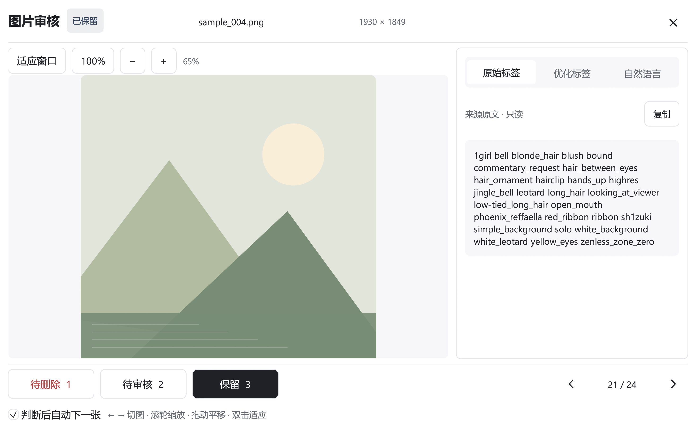

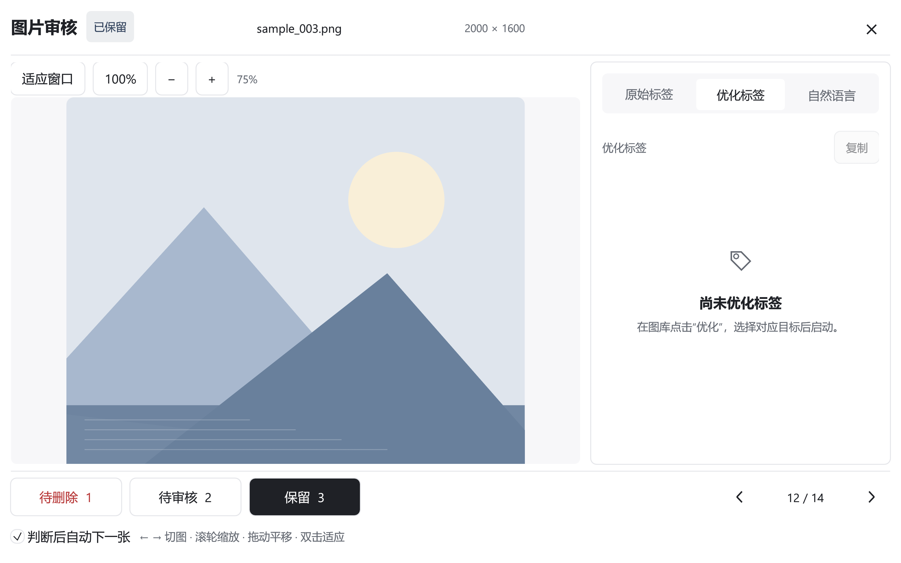

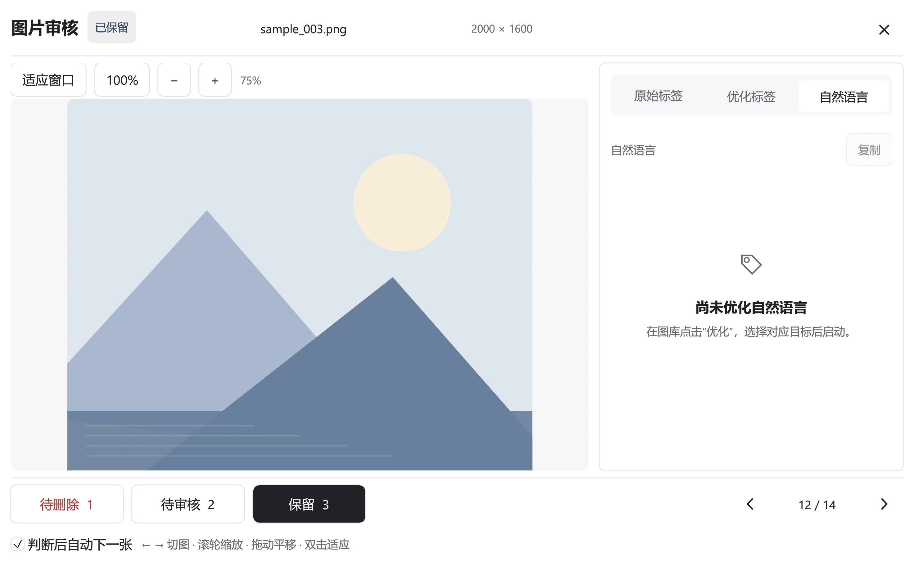

图片下方的紧凑工具栏提供缩放、加载原图和“打开原图”，后者用系统查看器打开文件。“描述”和“局部修复”按需打开右栏；裁剪不占右栏，直接点击第一行比例生成选区，再次点击当前比例取消选区，点其他比例切换；第二行“裁剪确认”直接保存，不受局部修复二次确认设置影响。三行高度固定，切换比例和重新框选不会挤动画布。“重新下载”直接显示在第二行，先提示替换当前裁剪／修复并保留备份，二次确认后才启动下载；取消或 Esc 不会下载，且只关闭确认框。重新框选、退出裁剪、恢复编辑前版本及局部修复二次确认设置收进“更多”。Inpainting 支持矩形、画笔、多边形选区及撤销／清空；选区用原始像素坐标，滚轮缩放、右键拖动平移不会改变遮罩。选择 Anime LaMa（二次元）或 LaMa（通用），开启二次确认时生成预览并确认替换；关闭时点击“去水印并保存”处理成功后直接保存。取消、关闭或切图丢弃未提交结果。默认本机处理，图片不会上传。

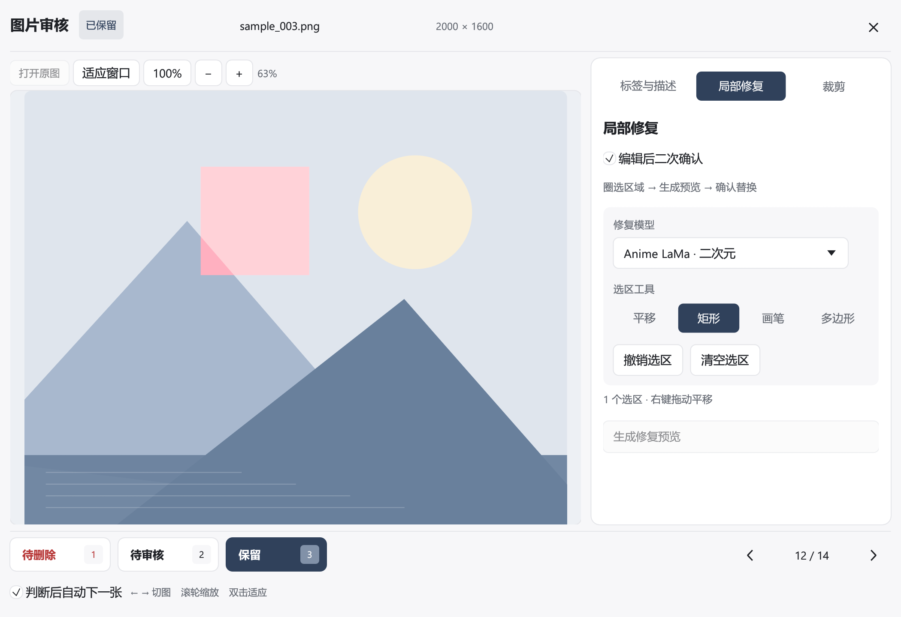

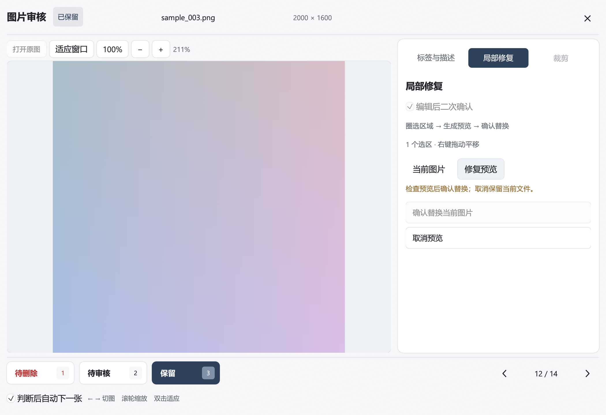

底部“拒绝”将不通过图片加入待删除清单，“通过”移除当前图标记并记录通过。标记阶段不修改图片或专属数据。可继续切图，结束审核或点击顶部“待删除 N”时核对整批清单。图库多选也提供垃圾桶入口，先汇总所选图片再打开清单。

确认窗口显示全部待删除图片的缩略图和文件名，长清单可滚动，每行可移除。只有点击“确认删除 N 张”才执行；取消、关闭或 Escape 均撤销待删除清单并保持图片与专属记录不变。确认后立即移除，无撤销窗口和回收站。切图按打开审核时的筛选与排序快照使用稳定 ID，删除后跳到范围内的下一张；范围删空则关闭详情。选中项、处理范围快照、页码、封面和统计同步更新。

示例删除仅影响本次会话，确认窗口明确标注示例。真实删除已接入原图、侧车、数据库记录和分析数据的协调清理及持久化清理日志；正在处理任务时禁止确认删除。跨进程协调及部分失败后的完整恢复交互仍需完善。D-069～D-077 的手动选区、LaMa 修复预览和确认替换已接入；AI 自动检测选区和远程修复仍待实现。

右侧现在为“标签与描述／局部修复／裁剪”。原始标签按画师、角色、通用标签分别呈现，另外保留作品、元标签和未分类标签；原文下划线和复制全文保持不变，不触发优化任务。裁剪支持自由框选、框内移动、四角调整和 1:1、4:3、3:4、3:2、2:3、16:9、9:16、原图比例。显示当前裁剪尺寸，支持居中或重新框选。开启二次确认时先在本地预览再确认；关闭时点击“裁剪并保存”处理成功后直接保存。两种模式均按现有格式替换当前文件，不保留裁剪前副本；取消保持当前图。预览使用裁剪后的宽高比，后续修复和导出使用保存后的尺寸。

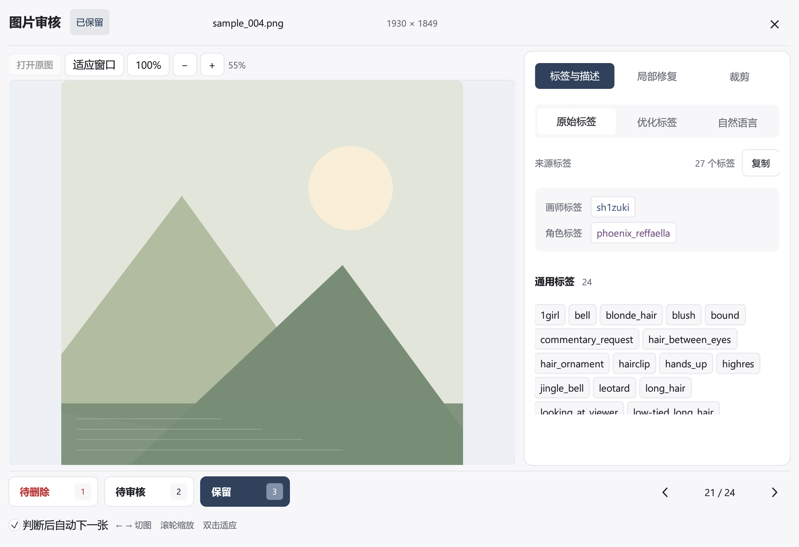

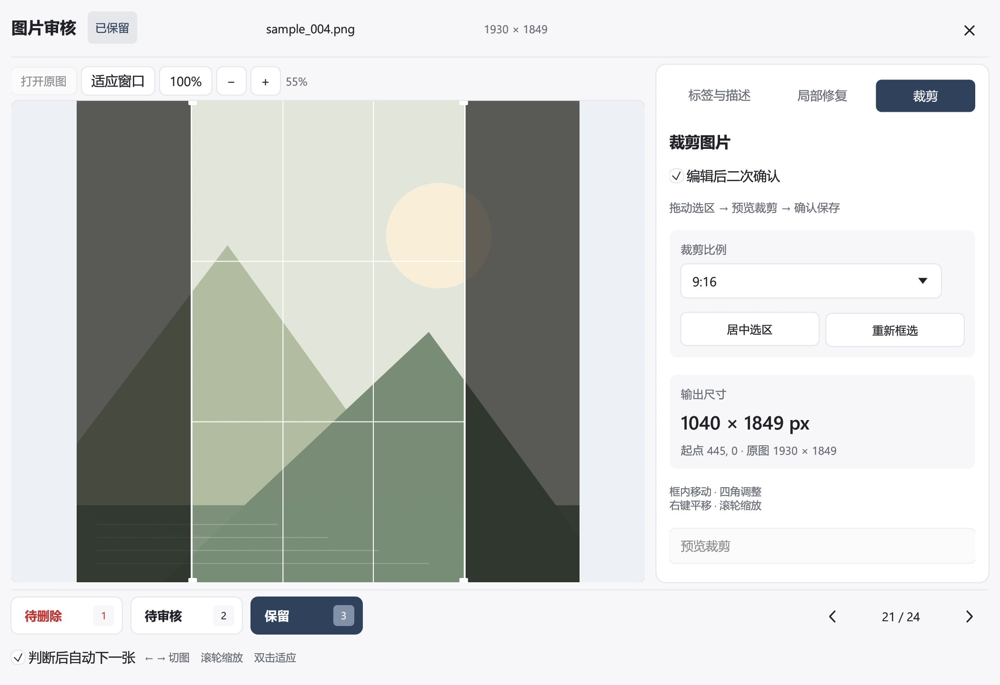

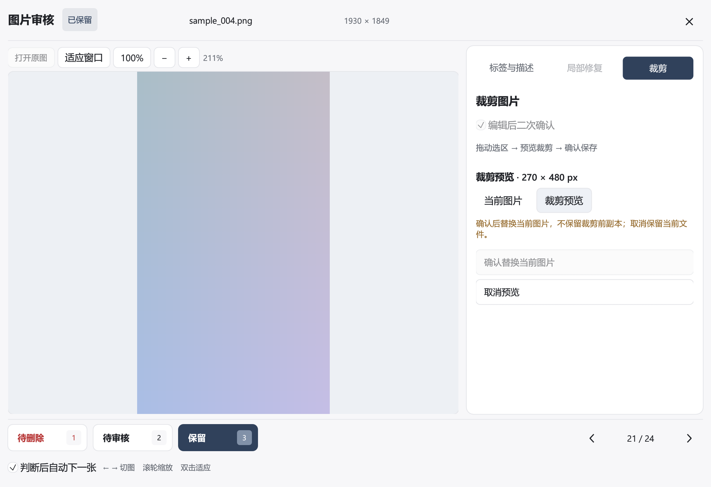

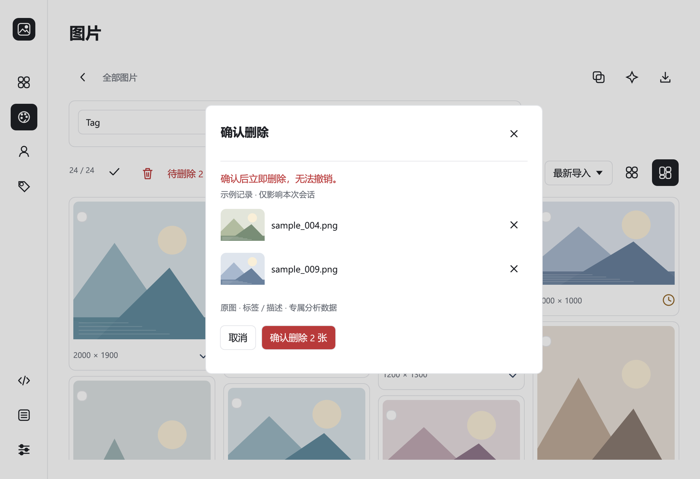

覆盖统计使用交集计算“三份文本齐全”；点击指标打开相应完成状态的图片，列表与指标使用相同数据范围。

### 导出、优化和去重

打开弹窗时建立处理范围快照。默认处理当前画师/角色或选中卡片关联的全部图片，忽略图片列表搜索；也可显式选择快照范围内的已选图片（D-114/115/116/118）。

导出和优化每次选择一种文本格式/目标：自然语言或标签。去重预览保留 pHash ≤ 2、DINOv3 ≥ 0.997 的信号规则及永久删除约定（以 D-123 至 D-132 的后续决定为准）。当前没有后端任务执行，开始按钮禁用并说明原因。

### API 与偏好保存

AI API 弹窗提供配置名称、服务基础地址、遮罩 API Key、模型、限流组和最大并发。服务地址用 URL 解析器校验，远程服务要求 HTTPS，本机服务允许 HTTP；拒绝地址中的用户名、密码、查询参数和片段。密钥与普通元数据分开：每个配置用持久化 ID 对应 Windows 凭据管理器中的独立条目，重名、改名或列表下标变化不影响绑定；旧配置自动补齐 ID。保存后清空输入，编辑只显示“已保存，留空保留”，不回填密钥。更换服务地址时必须填写新密钥或显式移除旧密钥，不能把原密钥隐式带到另一个服务。无需认证的服务可新建空密钥配置。

密钥输入旁的垃圾桶只移除当前配置的密钥；列表“移除”同时清理配置和密钥。存储失败保留原配置并展示脱敏错误，不能报告保存/移除成功。普通 RON 配置及日志不含密钥；取消、关闭或 Escape 清空未保存的密钥输入。当前安全存储仅支持 Windows，无明文回退。保存、编辑和启动不发起 HTTP 请求，连接测试与 AI 请求尚未接入，配置状态为已保存但未验证。

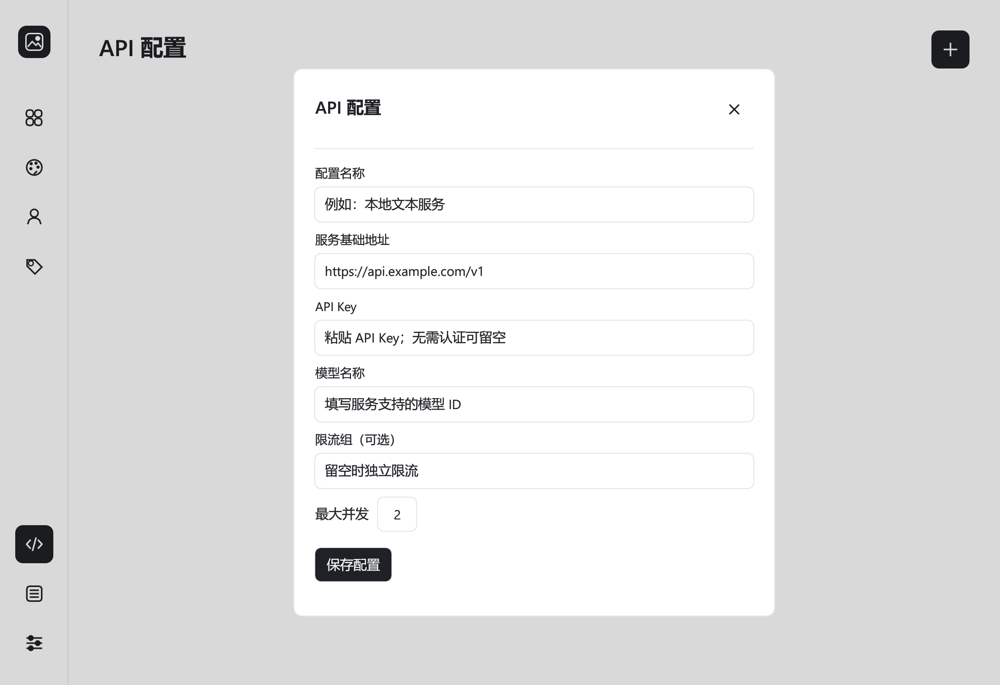

Danbooru 来源账号单独置于系统设置顶部：用户名、遮罩 API Key、获取密钥链接、保存状态。用户名/API Key 作为一个凭据写入 Windows 凭据管理器，固定服务 `Booru Dataset Manager`、账号标识 `danbooru`；普通 RON 配置仅保留非敏感用户名。保存成功后清空密钥输入；再次打开不回填密钥。留空保留同一账号的原密钥，更换用户名须输入新密钥；垃圾桶移除已保存凭据。失败时保留原有账号和凭据，不记录底层可能携带敏感信息的错误。

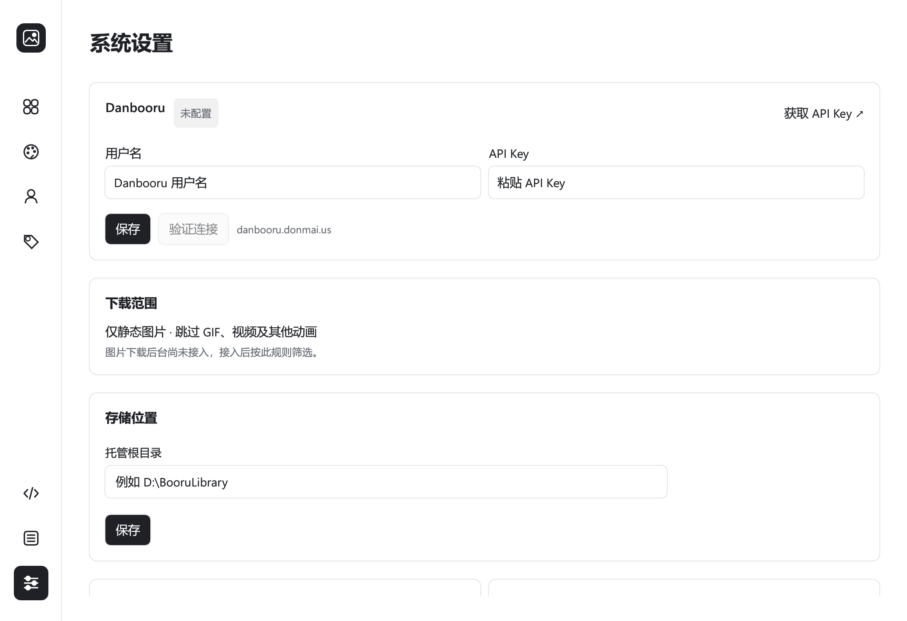

编辑后显示“未保存”，保存后显示“已保存 · 未验证”。保存和启动仅访问本机凭据存储，不请求 Danbooru；点击“验证连接”才在后台检查已保存账号身份，并显示正在验证、认证通过或失败原因。图片采集仍未实现。添加 Tag 时遇到 401 可直接展开凭据修复表单“保存并重试”，或主动选择“不使用账号重试”；原 Tag 保留，匿名模式仅用于当前添加弹窗。当前安全存储适配器仅支持 Windows，其他系统显示不可用，不回退到明文配置。截图与 UI 单测不读取真实凭据；原生存储验证使用独立的合成测试条目，并在测试后删除。

系统设置显示默认下载范围“仅静态图片 · 跳过 GIF、视频及其他动画”。旧偏好文件缺少该字段时同样采用此默认值；下载后台接入后按原始媒体类型及实际文件检查执行，当前 Tag 查询不下载文件。

UI 偏好及非敏感配置通过 eframe 保存为可读 RON 文件，默认路径为项目目录下的 `data/app.ron`。收藏、媒体与任务另存于 `data/catalog.sqlite3`，默认图片目录为 `data/library/`。开发程序根据可执行文件位置找到项目根目录，独立发行程序使用其所在目录。托管路径设置只影响后续下载，不迁移已有文件；系统设置显示实际数据库位置。

## 空状态、示例与真实服务

首次正常启动显示空收藏，后续启动恢复已保存记录，不提供示例入口或重复的未连接提示。开发者通过 `--preview` 参数显式加载 24 条内存媒体与程序生成的插画；窗口标题统一为 `Booru Dataset Manager`，按用户要求移除“示例”后缀。本文截图均为开发示例或合成查询状态，不代表真实媒体、成功远程查询或后台任务。预览和截图均不打开真实收藏库、不加载来源凭据、不查询远程 Tag。示例来源总数为固定值，未请求 API；图片/关联/审核数据均不持久化。

已实现导航、呈现、筛选、范围预览、UI 偏好、Tag 查询与收藏 SQLite；尚未实现媒体 SQLite、来源图片采集、缩略图缓存、AI、DINOv3、导出、备份与持久化任务。对应操作保持禁用并在悬停时说明原因，不模拟成功或展示虚构进度。示例图库采用当前页呈现；生产库仍需通过 application 层的分页查询与缩略图服务接入，不能把内存示例当作 50,000 张图片的性能实现。

## 代码组织与验证

- `apps/desktop/src/app.rs`：导航、会话状态、偏好保存、原生截图流程。
- `theme.rs` / `widgets.rs`：字体、配色、统一组件及明确标记的示例插画。
- `pages.rs` / `gallery.rs` / `dialogs.rs`：页面、卡片/图库、弹窗。
- `review.rs`：审核顺序、待删除清单、确认与取消、示例删除；生产文件删除尚未接入。
- `collections.rs`：画师/角色及关联唯一图片的冻结范围确认、级联删除和会话状态清理。
- `catalog.rs`：后台 Tag 查询、逻辑取消、来源确认、记录入库/加载与错误；基础设施的 `catalog.rs` 和 `danbooru.rs` 分别负责 SQLite 与 HTTP。
- `sources.rs`：来源凭据输入、保存状态、错误与安全存储端口调用；`crates/infrastructure/src/credentials.rs` 实现 Windows 凭据存储。
- `api_profiles.rs`：AI 配置的独立密钥绑定、安全保存/清理、地址变更保护与错误处理。
- `model.rs`：UI 偏好、非敏感 API 配置和示例模型；不替代 domain/application 的生产业务模型。

```powershell
cargo run -p bdm-desktop
cargo run -p bdm-desktop -- --preview
cargo run -p bdm-desktop -- --capture target/ui-captures
cargo run -p bdm-desktop -- --compact --capture target/ui-captures-compact
```

截图模式使用 egui 的原生 viewport 截图，自动遍历空库、示例总览、画师、角色、网格图库、标签、API、日志、设置、导出、瀑布流、详情、拒绝标记、删除确认、删除后切图、API 表单、记录删除选择、画师批量删除确认、删除后的画师列表和角色删除确认，以及添加 Tag 输入、查询等待、查询失败和来源结果，共 33 个状态（含 Cloudflare 网站验证提示、401 错误及凭据修复表单）。查询状态为合成数据且确认添加禁用。保存完成后写入 `capture.complete` 并退出。截图模式不保存应用偏好；使用 `--compact` 验证最小支持窗口。重复使用输出目录时需核对完成文件的修改时间，避免误读旧记录。

2026-10-20 的 Windows 原生截图分别完成 16 个状态：常规窗口在当前显示器上被限制为 1280×800 逻辑像素，紧凑窗口为 1050×720；缩放比例 200%。已人工检查常规与紧凑窗口的删除确认及删除后详情，无按钮遮挡或弹窗溢出。白色主题原有状态也完成截图；字体在此前按截图物理像素 1:1 检查。egui 使用自身的灰度字体栅格化，不能声称与 Windows ClearType 完全相同，也未验证所有显示器和缩放比例。窗口实际尺寸由完成记录确认，未把常规窗口的请求尺寸当作实际尺寸。

本次收藏查询修订完成 `target/ui-catalog-verified` 的 24 状态截图，stderr 为空；实际窗口为 981.3333×613.3333 逻辑像素，低于请求值。已检查输入、等待、失败和来源结果表单，无操作遮挡；1050×720 和 1440×960 另外由 UI 测试覆盖。截图结果不证明线上查询成功，匿名实测被拒绝；详情见 [实现状态](../planning/IMPLEMENTATION_STATUS.md)。

必须通过 workspace 的 fmt、test、clippy；原生截图需人工检查文字、间距、遮挡和溢出。UI 验证不代表后台工作流已实现。

Tag 查询错误区固定在弹窗宽度内换行。Cloudflare 网站验证、401 认证失败、普通 403 访问拒绝分别提示；网站验证和访问拒绝提供“在浏览器中检查 Danbooru”链接，输入保留且不入库。浏览器验证由用户手动处理，不承诺验证后应用请求必然通过。

2026-10-23: Settings cards use vector category icons and short labels, with detailed original/edit/download semantics in hover text. Image loading uses a thumbnail-to-original pictogram beside the persistent switch. Download and reset/save actions use accessible icon buttons; task counters use icons plus numeric values with hover names. Artist cards discovered from local provenance show their true local image count and “本地发现” until a remote total is known; artwork remains unobstructed by status text. References: `images/image-view-settings.png` and `images/discovered-artists.png`.


图片下载、去重、API 优化和导出的进度／继续／暂停／结果卡片统一在总览仪表盘展示。画师、角色列表及各自图库不重复显示全局任务卡片；启动按钮保留，继续使用当前选中的收藏或图片作为处理范围。发起任务后提示在总览查看进度，历史任务仍在运行日志中。
